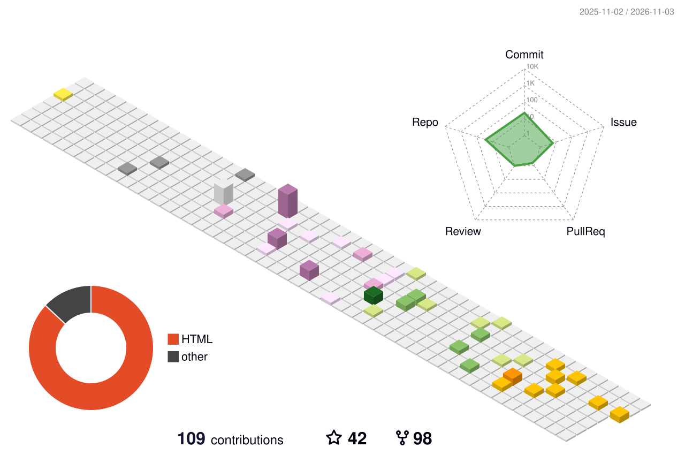

  

  

  
  
  

## 🧙 About me
My name is Tiago, but you can call me TJ.
I am an IxD/UI/UX Game Designer and my main focus is to bring clarity and fun to the obscure world of the games.

## 🛠️ Tools

  

## 🎮 My games
<table>
  <tr>
    <td align="center"><a href="https://tejota.itch.io/domination"> <b>DOMiNATiON</b></a></td>
    <td align="center"><a href="https://tejota.itch.io/par"> <b>PAR / A RAGE GAME</b></a></td>
    <td align="center"><a href="https://tejota.itch.io/cidade-dorme"> <b>Cidade Dorme</b></a></td>
  </tr>
  <tr>
    <td align="center"><a href="https://tejota.itch.io/mask-trigger"> <b>Mask Trigger!</b></a></td>
    <td align="center"><a href="https://tejota.itch.io/pumpqueen"> <b>PumpQueen</b></a></td>
    <td align="center"><a href="https://tejota.itch.io/timeless-bro"> <b>Timeless BRO</b></a></td>
  </tr>
</table>

  
<b>🕹️ More games (click to expand)</b>

   
  <table>
    <tr>
      <td align="center"><a href="https://tejota.itch.io/dice-loop"> <b>Dice Loop</b></a></td>
      <td align="center"><a href="https://tejota.itch.io/collapsi-digital-version"> <b>Collapsi (Digital Version)</b></a></td>
      <td align="center"><a href="https://tejota.itch.io/soda"> <b>The Forgotten Soda!</b></a></td>
    </tr>
    <tr>
      <td align="center"><a href="https://tejota.itch.io/bubblewave"> <b>BubbleWave</b></a></td>
      <td align="center"><a href="https://tejota.itch.io/pilgoth"> <b>Pilgoth: A RPG campaign.</b></a></td>
      <td align="center"><a href="https://nesges.itch.io/capture-the-flag-5e"> <b>Capture the Flag 5e</b></a></td>
    </tr>
  </table>

## ⭕ Play tic-tac-toe with me!
<!-- TTT:START -->

You are <b>❌</b>, my bot is <b>⭕</b>. Click an empty square to play! 👇

<table align="center">
  <tr>
    <td align="center" width="60" height="60"><a href="https://github.com/TeJota1337/TeJota1337/issues/new?title=ttt%7Cmove%7C0&body=Just%20click%20**Create**%20below%20%E2%80%94%20no%20need%20to%20write%20anything!%0A%0AThe%20bot%20will%20make%20its%20move%20and%20update%20the%20board%20in%20about%20a%20minute.%20%E2%8F%B1%EF%B8%8F">⬜</a></td>
    <td align="center" width="60" height="60"><a href="https://github.com/TeJota1337/TeJota1337/issues/new?title=ttt%7Cmove%7C1&body=Just%20click%20**Create**%20below%20%E2%80%94%20no%20need%20to%20write%20anything!%0A%0AThe%20bot%20will%20make%20its%20move%20and%20update%20the%20board%20in%20about%20a%20minute.%20%E2%8F%B1%EF%B8%8F">⬜</a></td>
    <td align="center" width="60" height="60"><a href="https://github.com/TeJota1337/TeJota1337/issues/new?title=ttt%7Cmove%7C2&body=Just%20click%20**Create**%20below%20%E2%80%94%20no%20need%20to%20write%20anything!%0A%0AThe%20bot%20will%20make%20its%20move%20and%20update%20the%20board%20in%20about%20a%20minute.%20%E2%8F%B1%EF%B8%8F">⬜</a></td>
  </tr>
  <tr>
    <td align="center" width="60" height="60"><a href="https://github.com/TeJota1337/TeJota1337/issues/new?title=ttt%7Cmove%7C3&body=Just%20click%20**Create**%20below%20%E2%80%94%20no%20need%20to%20write%20anything!%0A%0AThe%20bot%20will%20make%20its%20move%20and%20update%20the%20board%20in%20about%20a%20minute.%20%E2%8F%B1%EF%B8%8F">⬜</a></td>
    <td align="center" width="60" height="60"><a href="https://github.com/TeJota1337/TeJota1337/issues/new?title=ttt%7Cmove%7C4&body=Just%20click%20**Create**%20below%20%E2%80%94%20no%20need%20to%20write%20anything!%0A%0AThe%20bot%20will%20make%20its%20move%20and%20update%20the%20board%20in%20about%20a%20minute.%20%E2%8F%B1%EF%B8%8F">⬜</a></td>
    <td align="center" width="60" height="60"><a href="https://github.com/TeJota1337/TeJota1337/issues/new?title=ttt%7Cmove%7C5&body=Just%20click%20**Create**%20below%20%E2%80%94%20no%20need%20to%20write%20anything!%0A%0AThe%20bot%20will%20make%20its%20move%20and%20update%20the%20board%20in%20about%20a%20minute.%20%E2%8F%B1%EF%B8%8F">⬜</a></td>
  </tr>
  <tr>
    <td align="center" width="60" height="60"><a href="https://github.com/TeJota1337/TeJota1337/issues/new?title=ttt%7Cmove%7C6&body=Just%20click%20**Create**%20below%20%E2%80%94%20no%20need%20to%20write%20anything!%0A%0AThe%20bot%20will%20make%20its%20move%20and%20update%20the%20board%20in%20about%20a%20minute.%20%E2%8F%B1%EF%B8%8F">⬜</a></td>
    <td align="center" width="60" height="60"><a href="https://github.com/TeJota1337/TeJota1337/issues/new?title=ttt%7Cmove%7C7&body=Just%20click%20**Create**%20below%20%E2%80%94%20no%20need%20to%20write%20anything!%0A%0AThe%20bot%20will%20make%20its%20move%20and%20update%20the%20board%20in%20about%20a%20minute.%20%E2%8F%B1%EF%B8%8F">⬜</a></td>
    <td align="center" width="60" height="60"><a href="https://github.com/TeJota1337/TeJota1337/issues/new?title=ttt%7Cmove%7C8&body=Just%20click%20**Create**%20below%20%E2%80%94%20no%20need%20to%20write%20anything!%0A%0AThe%20bot%20will%20make%20its%20move%20and%20update%20the%20board%20in%20about%20a%20minute.%20%E2%8F%B1%EF%B8%8F">⬜</a></td>
  </tr>
</table>

🏆 Visitors <b>0</b> &nbsp;|&nbsp; 🤖 Bot <b>0</b> &nbsp;|&nbsp; 🤝 Draws <b>0</b>

Recent players: _nobody yet — be the first!_

Stuck? <a href="https://github.com/TeJota1337/TeJota1337/issues/new?title=ttt%7Cnew&body=Just%20click%20**Create**%20below%20%E2%80%94%20no%20need%20to%20write%20anything!%0A%0AThe%20bot%20will%20make%20its%20move%20and%20update%20the%20board%20in%20about%20a%20minute.%20%E2%8F%B1%EF%B8%8F">Start a new game</a> · You need to be logged in to GitHub to play.

<!-- TTT:END -->

## 📊 My contributions
<picture>
  <source media="(prefers-color-scheme: dark)" srcset="https://raw.githubusercontent.com/TeJota1337/TeJota1337/output/bomberman-contribution-graph-dark.svg">
  <source media="(prefers-color-scheme: light)" srcset="https://raw.githubusercontent.com/TeJota1337/TeJota1337/output/bomberman-contribution-graph.svg">
  
</picture>

_generated with [abozanona/pacman-contribution-graph](https://abozanona.github.io/pacman-contribution-graph/)_

<picture>
  <source media="(prefers-color-scheme: dark)" srcset="profile-3d-contrib/profile-night-rainbow.svg">
  <source media="(prefers-color-scheme: light)" srcset="profile-3d-contrib/profile-season-animate.svg">
  
</picture>

  <picture>
    <source media="(prefers-color-scheme: dark)" srcset="https://streak-stats.demolab.com/?user=TeJota1337&theme=dark&hide_border=true&background=0D1117&ring=B24BF3&fire=E100FF&currStreakLabel=B24BF3">
    <source media="(prefers-color-scheme: light)" srcset="https://streak-stats.demolab.com/?user=TeJota1337&hide_border=true&ring=7F00FF&fire=E100FF&currStreakLabel=7F00FF">
    
  </picture>

