

  

  

  
  
  

 

<picture>
  <source media="(prefers-color-scheme: dark)" srcset="https://raw.githubusercontent.com/TeJota1337/TeJota1337/output/bomberman-contribution-graph-dark.svg">
  <source media="(prefers-color-scheme: light)" srcset="https://raw.githubusercontent.com/TeJota1337/TeJota1337/output/bomberman-contribution-graph.svg">
  
</picture>

generated with <a href="https://abozanona.github.io/pacman-contribution-graph/">abozanona/pacman-contribution-graph</a>

<h2 align="center">🎮 My games</h2>

  <a href="https://tejota.itch.io/domination">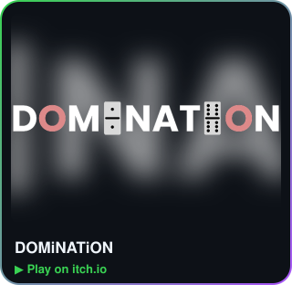</a>
  <a href="https://tejota.itch.io/par">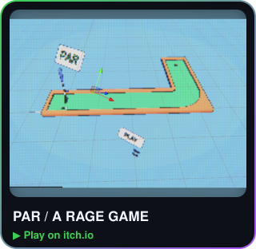</a>
  <a href="https://tejota.itch.io/cidade-dorme">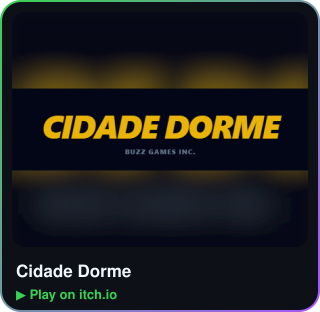</a>

  <a href="https://tejota.itch.io/mask-trigger">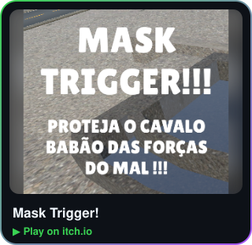</a>
  <a href="https://tejota.itch.io/pumpqueen">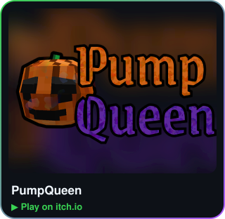</a>
  <a href="https://tejota.itch.io/timeless-bro">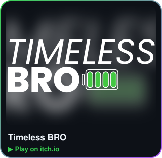</a>

  <a href="https://tejota.itch.io/dice-loop">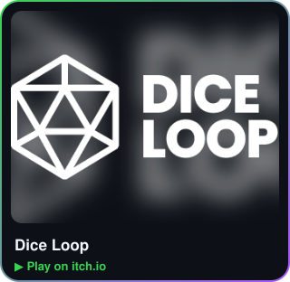</a>
  <a href="https://tejota.itch.io/collapsi-digital-version">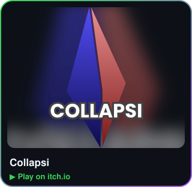</a>
  <a href="https://tejota.itch.io/soda">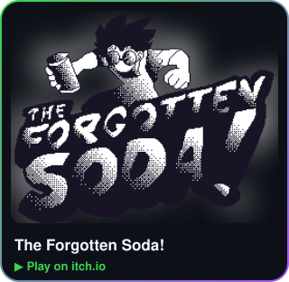</a>

  
  
  <a href="https://nesges.itch.io/capture-the-flag-5e">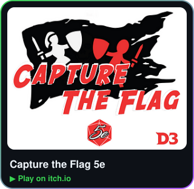</a>

 

  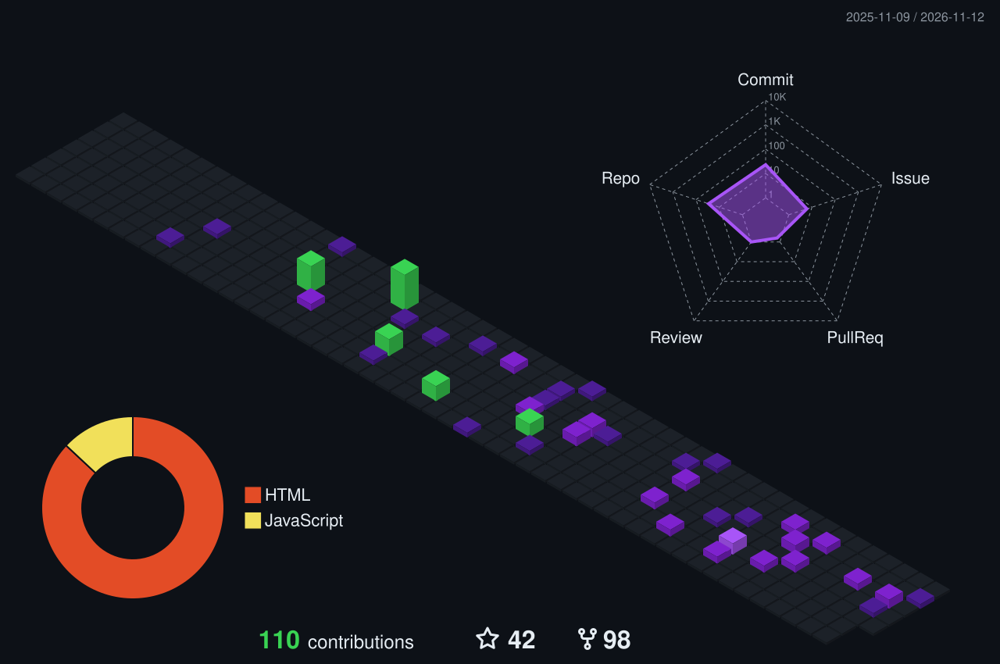

